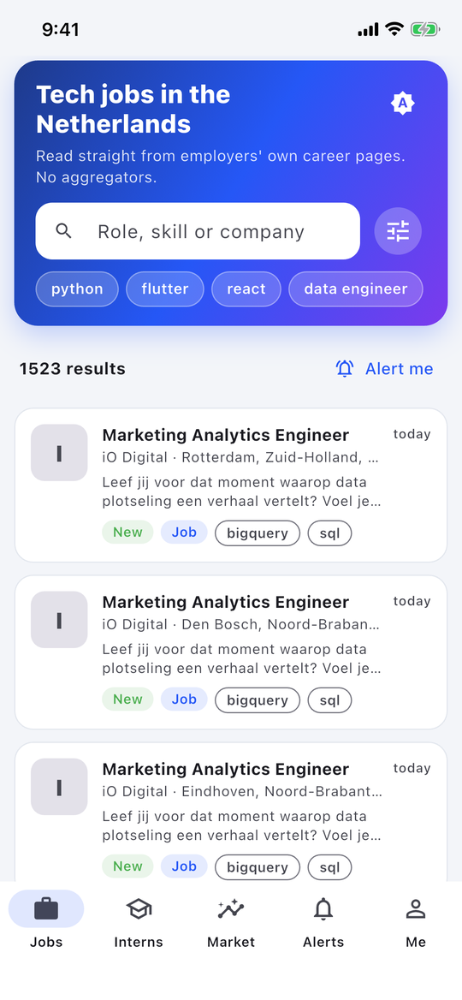
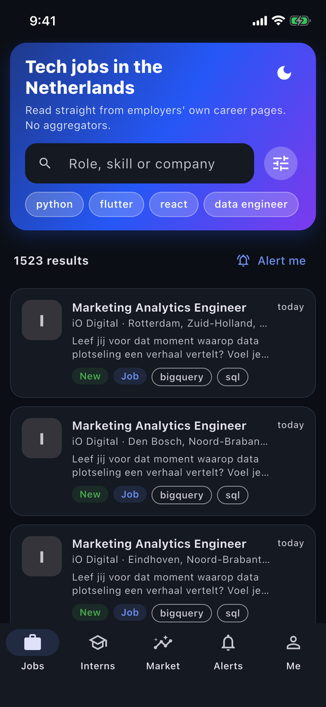
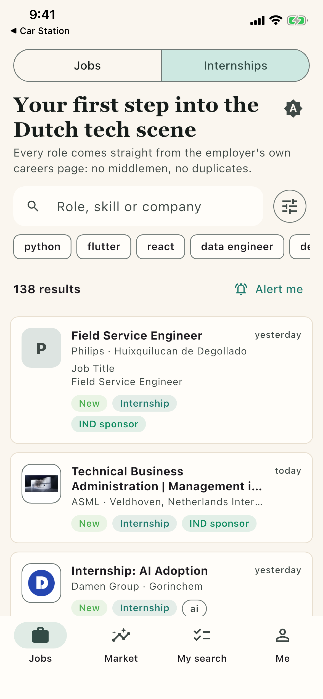
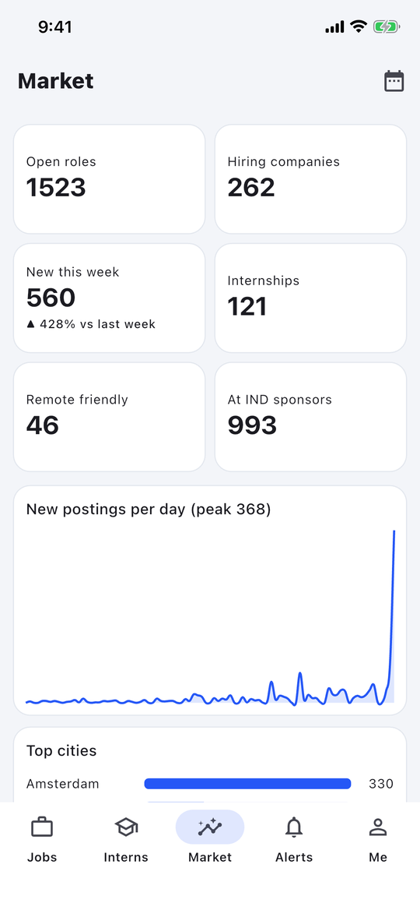
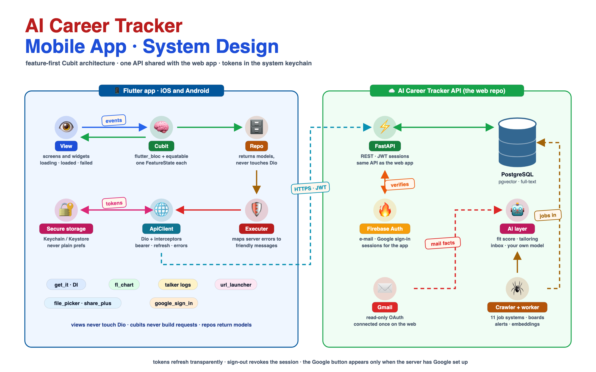
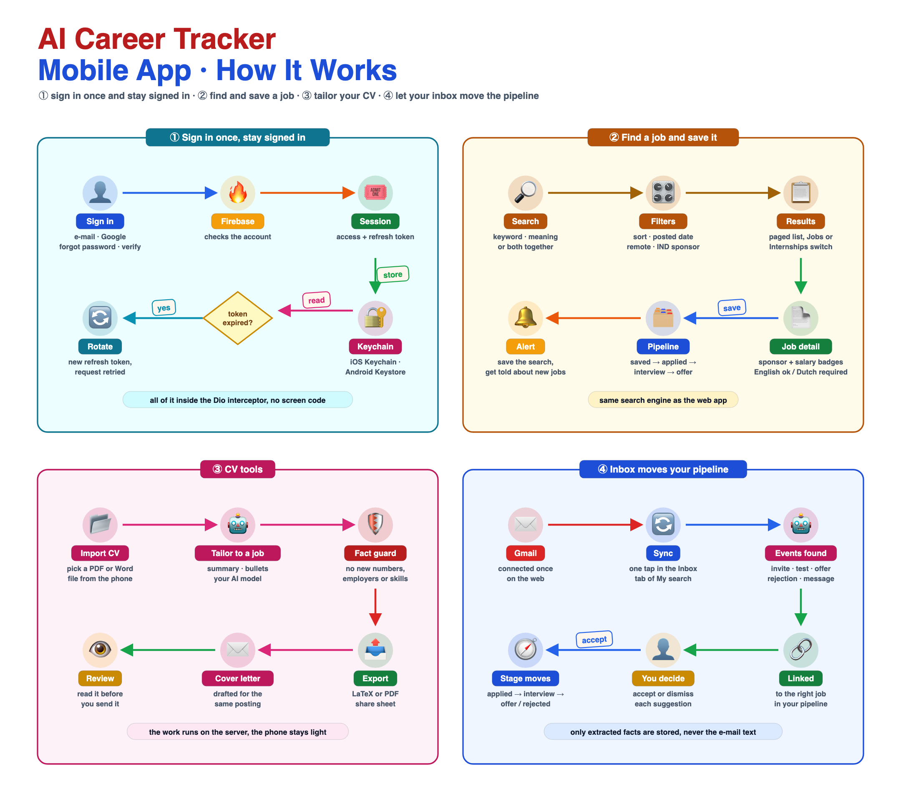
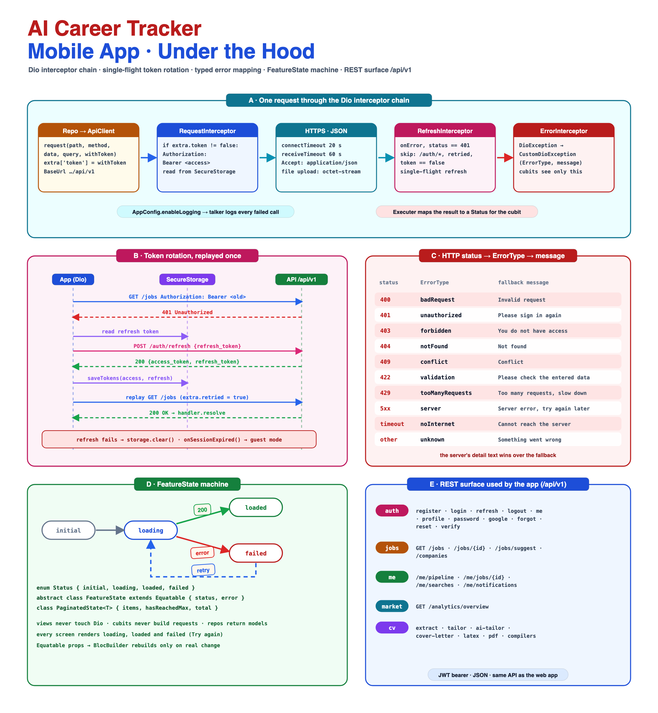

<h1 align="center">📱 AI Career Tracker · Mobile</h1>

<h3 align="center">Your job hunt in your pocket: jobs from employers' own career pages <i>and</i> the big job boards,<br>ranked for you, saved to a pipeline, and linked to the replies in your inbox.</h3>

<p align="center">
  <a href="https://ai-career-tracker-gmwn.onrender.com"></a>
  <a href="https://emelianchkaira.netlify.app"></a>
</p>

<p align="center"><a href="https://github.com/emelian-chkaira/ai-career-tracker-mobile/actions/workflows/ci.yml"></a></p>

<p align="center">
  
  
  
  
  
  
</p>

<p align="center">
  
  
  
  
  
  
  
</p>

<p align="center">
  
  
  
  
  
  
</p>

<p align="center">The mobile client of <b><a href="https://github.com/emelian-chkaira/ai-career-tracker">AI Career Tracker</a></b>. Same API, same plain warm design as the web app.</p>

<p align="center"><b><a href="#-quick-start">Quick start</a></b> · <b><a href="#-the-app-in-four-screens">Screens</a></b> · <b><a href="#-what-you-can-do">Features</a></b> · <b><a href="#-architecture">Architecture</a></b> · <b><a href="#-technology">Technology</a></b> · <b><a href="#-run-it">Run it</a></b></p>

---

## 🏆 What's behind the app

<table align="center">
<tr>
<td align="center" width="25%"><h1>6,583</h1><b>employers</b><br><sub>watched on their own career pages</sub></td>
<td align="center" width="25%"><h1>11,086</h1><b>open roles</b><br><sub>one card each, no reposts</sub></td>
<td align="center" width="25%"><h1>13,089</h1><b>visa sponsors</b><br><sub>matched to the NL IND register</sub></td>
<td align="center" width="25%"><h1>11</h1><b>AI providers</b><br><sub>Ollama, Claude, OpenAI, Groq…</sub></td>
</tr>
</table>

<sub>Live numbers from the shared backend's development database at the time of writing. The app shows them; the <a href="https://github.com/emelian-chkaira/ai-career-tracker">web repo</a> produces them.</sub>

## 🖼️ The app in four screens

<table>
<tr>
<td align="center" width="25%"><br><b>🔎 Jobs</b><br><sub>Search, quick chips and a filters sheet. Sponsor and language badges on every card.</sub></td>
<td align="center" width="25%"><br><b>🌙 Dark mode</b><br><sub>Follows the system, or toggle from the header. Same warm design as the web.</sub></td>
<td align="center" width="25%"><br><b>🎓 Internships</b><br><sub>One switch at the top of the first tab, no extra tab needed.</sub></td>
<td align="center" width="25%"><br><b>📊 Market</b><br><sub>Live stats: postings per day, top cities and companies, skill demand.</sub></td>
</tr>
</table>

<sub>Screenshots come from the iOS Simulator against the author's development data. Pipeline, Inbox and CV tools need a signed-in account, so they are not shown here.</sub>

## ⚡ Quick start

The backend has a one-click installer that also loads ready-made data (companies, open listings, the NL IND sponsor register):

```bash
git clone https://github.com/emelian-chkaira/ai-career-tracker.git
cd ai-career-tracker && ./setup.sh          # API on http://localhost:8787
```

Then, in this repo:

```bash
flutter pub get
flutter run --dart-define=API_URL=http://localhost:8787
```

## 💚 Why you'll like it

| | |
|---|---|
| 🎯 **Only real, current roles** | Every listing comes from the employer's own careers page (or a job board you opted into), folded to one card per role, so there is nothing to wade through. |
| 🛂 **Built for people moving to the Netherlands** | NL IND-sponsor badges, "English OK / Dutch required", salary checks. |
| 🗂 **One place for the whole search** | Jobs and internships behind a single switch; pipeline and Gmail inbox together under **My search**, alerts one tap away. |
| 📬 **Your inbox, sorted** | Interview invites, tests, offers and rejections found in Gmail (read-only) and linked to your pipeline. |
| 🔒 **Private by design** | Self-hosted backend, tokens in the system keychain, no tracking. |
| 🌗 **Calm and readable** | A flat, warm design with serif headings, light and dark. |

## 🚀 What you can do

| | |
|---|---|
| 🔎 **Search** | One search box with the same engine as the web (keyword, meaning, or both together), quick-chips and a filters sheet: sort, posted date, remote-friendly, NL IND sponsors only. |
| 🎓 **Jobs / Internships** | A switch at the top of the first tab. |
| 🛂 **Sponsor and language badges** | NL IND-sponsor status per employer; "Dutch required" / "English ok" per posting. |
| 📊 **Market** | KPI tiles, postings per day, top cities and companies, contract types, skill demand (`fl_chart`). |
| 🗂 **My search** | Two tabs: **Pipeline** (saved → applied → interview → offer, with notes) and **Inbox**. The bell in the header opens your saved searches and alerts. |
| 📬 **Inbox** | The events found in your Gmail (applications, interviews, tests, offers, rejections): accept or dismiss them, and start a sync. Connecting Gmail and choosing the AI model that reads your mail are done once on the web. |
| 📄 **CV tools** | Import your CV, tailor it to a job, export and share the LaTeX/PDF, draft a cover letter. The server's **fact guard** rejects any new number, employer or skill your CV does not already contain. |
| 👤 **Accounts** | Sign in / sign up, **Continue with Google**, forgot password, e-mail verification. Tokens live in Keychain / Keystore. |
| 🌗 **Light and dark** | Follows the system, or toggle from the header. |

## 🏗️ Architecture

**System design:** the feature-first Cubit layers inside the app, and the backend they talk to.

<p align="center"></p>

**How it works:** signing in and staying signed in, finding and saving a job, tailoring your CV, and the inbox moving your pipeline.

<p align="center"></p>

**Under the hood:** the technical view. One request through the Dio interceptor chain, single-flight token rotation, status-to-error mapping, the `FeatureState` machine and the REST surface the app uses.

<p align="center"></p>

<sub>Vector versions: <a href="docs/media/app-architecture.svg">app-architecture.svg</a> · <a href="docs/media/app-how-it-works.svg">app-how-it-works.svg</a> · <a href="docs/media/app-technical.svg">app-technical.svg</a> · regenerate with <code>python3 docs/media/app_architecture.py</code>, <code>app_how_it_works.py</code>, <code>app_technical.py</code> and then <code>render_png.py</code></sub>

The code follows the same split:

```
lib/
├─ app/
│  ├─ features/<feature>/{cubit, models, repo, view}   auth · jobs · companies · alerts · dashboard · pipeline · inbox · my · cv · profile
│  └─ global/widgets                                   shared widgets (TryAgain, Pill, Section, SignInPrompt …)
└─ core/
   ├─ api/            Dio ApiClient · endpoints · interceptors (auth header, refresh-token rotation, errors) · Executer
   ├─ base_states/    FeatureState · Status · PaginatedState
   ├─ database/       secure token storage
   ├─ routes/         AppRouter           ├─ styles/   theme, HeroBanner, ThemeController
   └─ utils/          get_it dependency registration
```

Every screen has a **loading / loaded / failed** state with a *Try again* action, and server errors are mapped to friendly messages (`CustomDioException`).

## 🧰 Technology

| Layer | Technologies |
|---|---|
| **UI** | Flutter (Material 3) · custom flat warm theme · serif headings · light and dark |
| **State** | flutter_bloc (Cubit) · equatable · a `FeatureState` with loading, loaded and failed per screen |
| **Networking** | Dio with interceptors: bearer token, **automatic refresh-token rotation**, error mapping |
| **Dependency injection** | get_it, no code generation |
| **Secure storage** | flutter_secure_storage (iOS Keychain · Android Keystore): tokens never sit in plain preferences |
| **Charts** | fl_chart for the Market dashboard |
| **Auth** | Backend sessions over Firebase Authentication · google_sign_in |
| **Links and files** | url_launcher · file_picker · path_provider · share_plus |
| **Logging** | talker: readable network logs |
| **Quality** | flutter_lints · `flutter analyze` · unit tests · GitHub Actions CI |
| **Backend behind it** | Python · FastAPI · PostgreSQL 16 + pgvector · Playwright crawler · Gmail API · Docker, deployed as a [live web demo](https://ai-career-tracker-gmwn.onrender.com) on Render with Neon Postgres, see the [web repo](https://github.com/emelian-chkaira/ai-career-tracker) |

## 🏅 Highlights

- 🎨 A coherent design system shared with the web: flat surfaces, thin lines, teal and amber accents, serif headings.
- 🔐 Token refresh with rotation happens transparently in the Dio interceptor; sign-out revokes the session; the Google button only appears when the server has Google configured.
- 🧱 Clean boundaries: views never touch Dio, cubits never build requests, repos return models.
- 🔁 Web and mobile stay in sync: same four areas (Jobs, Market, My search, Me) and the same wording.

## ⚡ Run it

```bash
flutter pub get
flutter run --dart-define=API_URL=http://localhost:8787
```

| Target | `API_URL` |
|---|---|
| iOS Simulator | `http://localhost:8787` |
| Android emulator | `http://10.0.2.2:8787` |
| Real phone | your computer's LAN IP, or your deployed `https://…` URL |

The API comes from the [web repo](https://github.com/emelian-chkaira/ai-career-tracker). Its one-click installer (`./setup.sh`) starts everything and loads ready-made data, so the app has jobs to show the first time you open it.

<details>
<summary><b>Sign in with Google (optional)</b></summary>

1. Set up Firebase and the OAuth clients as described in the backend repo's [`docs/FIREBASE.md`](https://github.com/emelian-chkaira/ai-career-tracker/blob/main/docs/FIREBASE.md).
2. iOS: add the reversed client ID as a URL scheme in `ios/Runner/Info.plist` and build with `--dart-define=GOOGLE_IOS_CLIENT_ID=<iOS client ID>`.
3. Android: create an Android OAuth client with package `nl.careertracker.career_tracker` and your signing key's SHA-1.

The button appears automatically once the server reports a Google client ID.
</details>

<details>
<summary><b>Quality and status</b></summary>

```bash
flutter analyze
flutter test
```

CI (`.github/workflows/ci.yml`) runs `flutter pub get` and `flutter analyze` on every push.

The iOS app has been run and checked on the iOS Simulator. Not yet verified: Android builds, the Google button against a live Google client, and the CV import / export screens on a physical device.
</details>

---

<p align="center"><sub>👤 Built by Emelian Chkaira: <a href="https://emelianchkaira.netlify.app">portfolio website</a></sub></p>

<p align="center"><sub>🖥️ Web app and backend: <a href="https://github.com/emelian-chkaira/ai-career-tracker">ai-career-tracker</a> · 📐 <a href="https://github.com/emelian-chkaira/ai-career-tracker/blob/main/PLAN.md">Design notes</a></sub></p>
